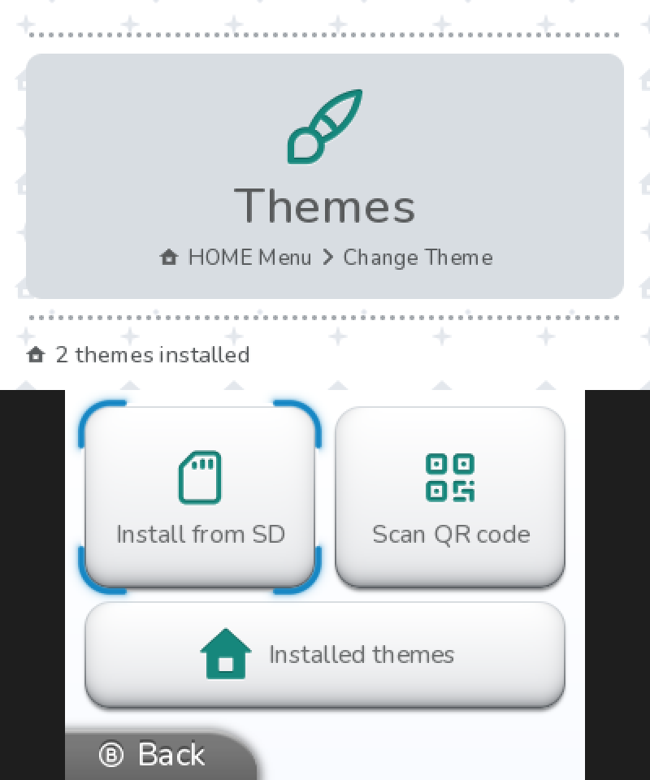
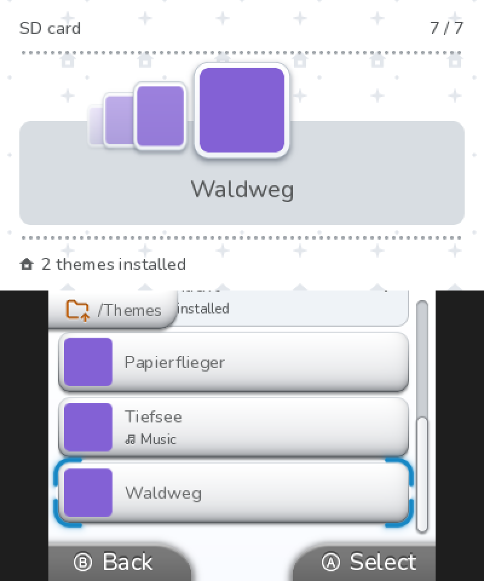
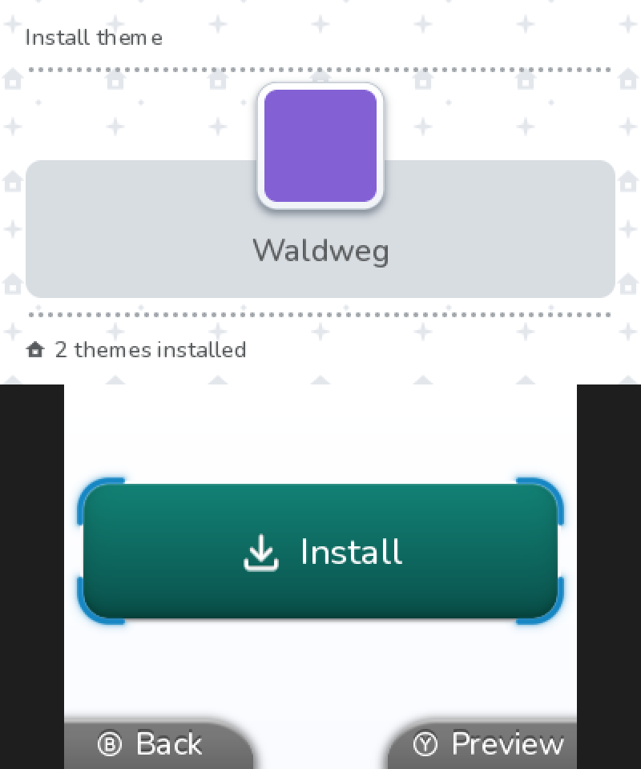
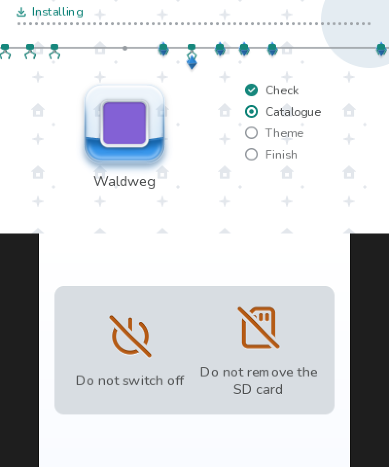
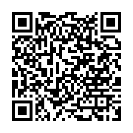

# 3DStockTheme

A Nintendo 3DS homebrew application that installs custom themes and badge sets into the HOME Menu's own systems. A theme you install shows up under "Change Theme" like an official one, with its name and icon, works with shuffle and with saved layouts, and can be deleted there again.

> [!IMPORTANT]
> **European consoles only, for now.** The application writes to the European theme title and has run on two European consoles, a New 3DS XL and a New 2DS XL. On a console of another region it has not been tried and is not expected to work. Help to bring it to other regions is very welcome: see [Other regions](#other-regions).

| Themes | From the SD card | Install | Installing |
| --- | --- | --- | --- |
|  |  |  |  |

The pictures are drawn by the project's own renderer with stand-in themes: a violet square is where a theme's icon shows. On the console the text is set in the system font.

## What it does

- **Installs a theme** from the SD card (a theme zip in the Anemone / Theme Plaza format, or a "theme installer" CIA, in `/Themes`) or from a QR code that links to one.
- **Previews** a theme's wallpapers and music first, and installs it with or without its music.
- **Deletes** an installed theme, or the file it came from.
- **Adds a badge set** (a folder or a zip of PNG files, from `/Badges` or by QR code) to the HOME Menu's badge collection, and removes the last set it added.
- **Looks good doing it**: four looks, eight colour schemes, interface sounds and menu music, in English and German after the console's language. The interface is the [3ds-uikit](https://github.com/albxncom/3ds-uikit) library, which was cut out of this application.

## Before you start

- **Homebrew access**: a 3DS with custom firmware and a title installer such as FBI.
- **A European console**: the application works on the European theme title (`0004008C00009809`) and has run on two European consoles, a New 3DS XL and a New 2DS XL. Other regions are untested and not expected to work.
- **Nothing else to install first**: the first theme you install creates the theme pack on title `0004008C00009809` and its record on the SD card; every later theme is added to it. A pack built on a computer with [`tools/theme-pack`](tools/theme-pack/README.md) still works, with its record copied to the card ([Seeding the record from the Mac](docs/README.md#seeding-the-record-from-the-mac)).
- **Never remove the pack in System Settings, Data Management**: it lists all theme titles as one entry, so it would very likely remove the official themes too ([why](tools/theme-pack/README.md#install-console)). To remove the pack, delete the title and the ticket of `0004008C00009809` in FBI, after checking the ID digit by digit.
- **For sound**: the DSP firmware dump on the card (`sdmc:/3ds/dspfirm.cdc`); without it the application runs silent. To make it with Luma3DS: in the HOME Menu, press L + D-Pad Down + Select to open the Rosalina menu, choose "Miscellaneous options", then "Dump DSP firmware". Rosalina writes the file to that place; start the application again afterwards.
- **A backup**: the application writes to the theme title and to the HOME Menu's badge data. The first install, which creates the theme pack, is new in 1.0.0-beta.2 and was seen on a console on 2026-11-23, a New 2DS XL that never had the pack. Back up your SD card and your badge data before you use it.

## Install

Take `3DStockTheme.cia` from the [releases](https://github.com/albxncom/3dstocktheme/releases) and install it with FBI, or put `3DStockTheme.3dsx` into `/3ds/` and start it from the Homebrew Launcher.

Or straight on the console: in FBI choose "Remote Install", then "Scan QR Code", and scan this code. It holds the address of the latest release's CIA, so the same code also updates an installed copy. The application is all the console needs: it creates the theme pack itself with the first theme, so no computer is involved.



## Build

```sh
git clone --recurse-submodules https://github.com/albxncom/3dstocktheme
cd 3dstocktheme
docker run --rm --network none --platform linux/amd64 -v "$PWD":/src -w /src devkitpro/devkitarm:20260610 make app
```

This writes `app/build/3DStockTheme.3dsx`. How the CIA is built is under [Build](docs/README.md#build-1) in the technical reference, what `make test` needs on a computer under [Tests](docs/README.md#tests).

## Layout

| Folder | What it holds |
| --- | --- |
| `app/` | the 3DS application |
| `core/` | its engine in plain C: reads theme files and badge sets, writes the pack's contents; builds for the 3DS and for the host |
| `uikit/` | the interface library, a git submodule |
| `host/` | the tests, which run on a computer |
| `tools/` | the build and check scripts, the renderer that draws the application's screens, and the two Python tools `theme-pack/` and `badges/` |
| `docs/` | [the technical reference](docs/README.md) and this page's pictures |

## Other regions

**Help wanted.** Today the application is for European consoles only. If you have a console of another region and want it there, open an issue or a pull request. What is tied to the region, as far as it is known:

- **The theme title**: `TP_TITLE_ID` in [`core/tp.h`](core/tp.h) is the European theme title (`0004008C00009809`), and [`tools/theme-pack`](tools/theme-pack/README.md) builds the pack for the same title.
- **The catalogue**: the list of themes the HOME Menu reads is written with the region record and the languages of a European console (`MetaDataContentHeader.bin` in the pack tool's README).
- **What was read in the HOME Menu's code** comes from the European HOME Menu of system version 11.17. Whether another region's behaves the same is not known.
- **The Badges part** has only run on European consoles. Whether it depends on the region is not known.

The most useful first step is a test on a console of another region, with a backup first: the pack tool's README names the console tests that passed in Europe (T1 to T3).

## Status

Version 1.0.0-beta.2. What it cannot do yet is listed under [Limits](docs/README.md#limits): among other things one theme per install, at most 100 themes in the pack, and only the last badge set can be removed.

## Credits and licence

The repository's own files are under the zlib licence, see [`LICENSE`](LICENSE). The application links libctru, citro2d and citro3d (zlib), libcurl (curl licence) with mbedtls (Apache-2.0), and holds quirc (ISC) for QR codes; the icons are Tabler Icons (MIT), the interface sounds are by Kenney (CC0), the music is by Peachtea and MintoDog (CC0). Every source with its version is in [the technical reference](docs/README.md#dependencies) and in the kit's credits.

3DStockTheme was built with [Claude Code](https://claude.com/product/claude-code), Anthropic's coding agent.

This project is not affiliated with Nintendo, and nothing of Nintendo's is in the repository. Use it at your own risk.
